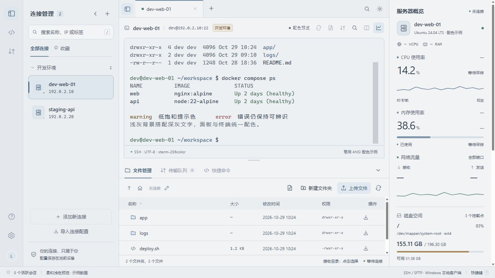

# Aster SSH

轻量、清爽的 Windows SSH / SFTP 桌面客户端，使用 Go + Wails + xterm.js，运行时使用系统 WebView2，不依赖 Java 或 Node.js。



截图使用示例数据。支持 Windows 10 / 11 x64。

## 功能

- SSH 密码 / 私钥认证、多会话标签、独立终端分屏、搜索与快捷命令。
- SFTP 文件浏览、UTF-8 文本编辑、文件与文件夹递归上传 / 下载、传输队列与取消。
- Linux CPU、内存、网络、挂载点与物理磁盘监控。
- 本地端口转发、会话日志、首次连接主机指纹确认和 Windows DPAPI 凭据加密。
- 柔和浅色 / 深色主题，可收起连接栏与监控面板。

## 使用

当前版本放在 `releases/1.0.3/`。可以使用安装程序，或解压便携版后启动 `AsterSSH.exe`。升级时先关闭旧版；已有连接与凭据继续保存在同一用户数据目录。默认使用柔和浅色主题：浅灰背景、深灰文字、低饱和蓝色，面板与终端统一切换配色。

[安装版](releases/1.0.3/AsterSSH-Setup.exe) · [便携版](releases/1.0.3/AsterSSH-Portable.zip) · [独立程序](releases/1.0.3/AsterSSH.exe) · [SHA-256 校验值](releases/1.0.3/SHA256SUMS.txt)

详细操作见 [使用说明](docs/使用说明.md)，测试范围见 [验证记录](docs/验证记录.md)。

## 项目结构

```text
app.go / main.go         桌面生命周期、原生对话框和前后端接口
internal/core/           SSH、SFTP、DPAPI 存储、传输、监控和端口转发
internal/testserver/     仅供开发验证的内存 SSH / SFTP 服务
cmd/ssh-test-server/     本机测试服务启动入口，不随软件分发
frontend/src/            正式界面、终端和文件管理代码
frontend/dist/           嵌入到程序的前端构建结果
build/                   图标、Windows 元数据和构建输出
installer/               当前用户范围安装 / 卸载程序源码
scripts/                 可复用的构建、打包脚本
docs/                    使用说明和验证记录
releases/                最终可运行 / 安装的文件
prototype/               最初确认的交互原型，保留作设计参考
.tools/                  本机工具链和隔离验证数据（忽略提交）
```

## 构建

需要 Go 1.26+、Node.js 22+、pnpm 11、Wails CLI 2.17.0，以及 Windows 自带的 .NET Framework C# 编译器（制作安装程序）。本机的 `.tools/` 工具链与测试数据不包含在仓库中；也可直接使用 PATH 中的工具。

```powershell
git clone https://github.com/Saito912/aster-ssh.git
cd aster-ssh
go install github.com/wailsapp/wails/v2/cmd/wails@v2.17.0
# 确保 go、node、pnpm 和 wails 位于 PATH。
.\scripts\Build.ps1
```

运行 `scripts/Build.ps1` 执行前端构建、Go 测试、Wails 打包和交付归档。`go.mod`、`go.sum` 和 `frontend/pnpm-lock.yaml` 固定依赖。普通开发运行 `wails dev`，此前应先构建 `frontend/dist`。

用户配置保存在 `%APPDATA%\AsterSSH`；开发测试可用进程环境变量 `ASTER_DATA_DIR` 指向独立绝对路径，避免污染日常配置。

`prototype/` 是早期交互演示，使用模拟数据；正式客户端源码位于项目根目录、`internal/` 和 `frontend/`。项目当前提供的功能及限制详见使用说明。
